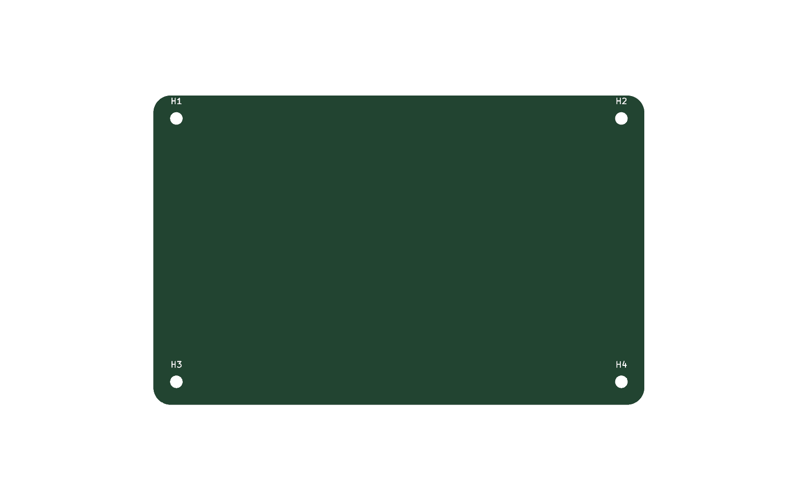

<!-- datasheet:banner -->

  <picture>
    <source media="(prefers-color-scheme: dark)" srcset=".github/assets/banner-dark.svg">
    
  </picture>

<!-- /datasheet:banner -->

# Card Wallet

**A minimalist mechanical card wallet plate designed as an FR4 printed circuit board (PCB) in KiCad, matched to ISO/IEC 7810 ID-1 card dimensions (`85.6 × 54.0 mm`).**

  
  

<!-- datasheet:figure -->
## At a glance

  <picture>
    <source media="(prefers-color-scheme: dark)" srcset=".github/assets/diagram-dark.svg">
    
  </picture>

| Characteristic | Detail |
| --- | --- |
| **Dimensions** | `85.60 × 54.00 mm` with `3.0 mm` corner radii (`Edge.Cuts` from `(100.0, 100.0)` to `(185.6, 154.0)`) — exact ISO/IEC 7810 ID-1 credit-card footprint |
| **Material & stackup** | `1.0 mm` (or `1.6 mm`) 2-layer FR-4 glass-epoxy laminate; zero electrical nets |
| **Mounting holes** | Four `2.2 mm` non-plated through-holes (`H1`–`H4`, `MountingHole_2.2mm_M2`) inset `4.0 mm` from each corner (`77.6 × 46.0 mm` center spacing) |
| **Primary PCB file** | [`card_board.kicad_pcb`](card_board.kicad_pcb) holds the complete mechanical outline and NPTH array |
| **Pre-plotted fab outputs** | [`card-Edge_Cuts.gm1`](card-Edge_Cuts.gm1) (Gerber board outline) and [`card-NPTH.drl`](card-NPTH.drl) (Excellon non-plated drill file) |
<!-- /datasheet:figure -->

## Quick start & fabrication

1. **Inspect or customize in KiCad:** Open [`card_board.kicad_pcb`](card_board.kicad_pcb) in KiCad 8 or newer (`pcbnew`) to adjust silkscreen art, copper fills, or hole diameters.
2. **Order two plates from any PCB house (JLCPCB, PCBWay, OshPark, Robu):**
   - Upload [`card-Edge_Cuts.gm1`](card-Edge_Cuts.gm1) and [`card-NPTH.drl`](card-NPTH.drl) (or export a full Gerber zip from `card_board.kicad_pcb`).
   - Select **FR-4**, **1.0 mm** or **1.6 mm** thickness, matte black or green solder mask, and lead-free HASL or ENIG finish.
3. **Assemble:** Join two plates with an elastic band or M2 standoffs/screws through the four `2.2 mm` corner holes (`H1`–`H4`).

## Repository files

| File | Purpose |
| --- | --- |
| [`card_board.kicad_pcb`](card_board.kicad_pcb) | Production KiCad PCB layout (`85.6 × 54.0 mm`, `R3.0 mm` rounded corners, four `2.2 mm` M2 NPTH holes) |
| [`card-Edge_Cuts.gm1`](card-Edge_Cuts.gm1) | Gerber `Edge.Cuts` board outline for direct fabrication upload |
| [`card-NPTH.drl`](card-NPTH.drl) | Excellon drill file for the four `2.2 mm` non-plated corner holes |
| [`Card Wallet.kicad_pro`](Card%20Wallet.kicad_pro), [`Card Wallet.kicad_sch`](Card%20Wallet.kicad_sch), [`Card Wallet.kicad_pcb`](Card%20Wallet.kicad_pcb) | KiCad project wrapper and blank schematic/board stubs created with the project |
| [`docs/render-top.png`](docs/render-top.png), [`docs/render-bottom.png`](docs/render-bottom.png) | Raytraced top and bottom renders generated via `kicad-cli pcb render` |

## Absolute maximum ratings

| Parameter | Limit |
| --- | --- |
| Board outline (`W × H`) | `85.60 × 54.00 mm` (`±0.2 mm` typical CNC routing tolerance) |
| Corner radius | `3.00 mm` |
| Corner hole drill (`H1`–`H4`) | `2.20 mm` NPTH (clears standard `M2` fasteners) |
| Hole center-to-edge inset | `4.00 mm` (`2.90 mm` minimum web from hole edge to board edge) |
| Nominal board thickness | `1.0 mm` in `card_board.kicad_pcb` (`1.6 mm` standard fab option also supported) |

## Errata

- **`card_board.kicad_pcb` vs `Card Wallet.kicad_pcb`:** The routed mechanical layout lives in [`card_board.kicad_pcb`](card_board.kicad_pcb). `Card Wallet.kicad_pcb` is an empty project stub created alongside `Card Wallet.kicad_pro`.
- **Two-layer fab requirement:** Some low-cost PCB fabricators require top/bottom copper (`F.Cu`/`B.Cu`) and solder mask (`F.Mask`/`B.Mask`) files in addition to `card-Edge_Cuts.gm1` and `card-NPTH.drl`; plot all standard layers from `card_board.kicad_pcb` if your fabricator rejects outline-only zips.

## License

MIT. See [LICENSE](LICENSE).
