<!-- datasheet:banner -->

  <picture>
    <source media="(prefers-color-scheme: dark)" srcset=".github/assets/banner-dark.svg">
    
  </picture>

<!-- /datasheet:banner -->

# Card Wallet

A minimalist mechanical card wallet designed as an FR4 printed circuit board (PCB) in KiCad.

<!-- datasheet:figure -->
## At a glance

  <picture>
    <source media="(prefers-color-scheme: dark)" srcset=".github/assets/diagram-dark.svg">
    
  </picture>

<!-- /datasheet:figure -->

## Features
- Mechanical card holder using FR4 PCB material properties
- Custom edge cuts and non-plated through hole (NPTH) mounting geometry
- Designed in KiCad 8 / 9
